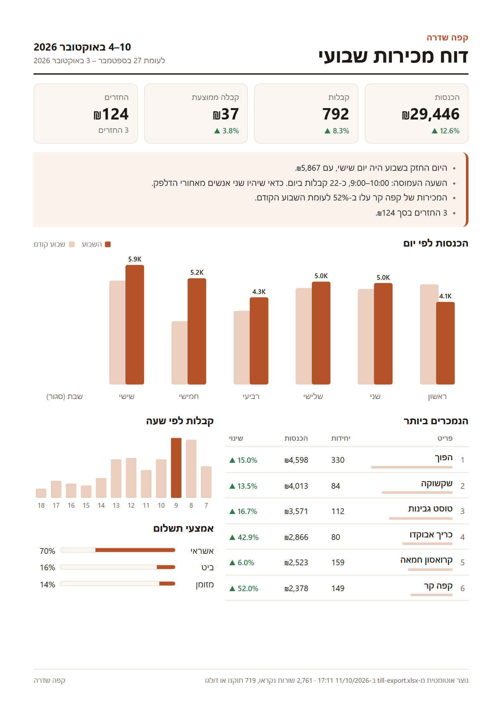

# Weekly sales report

Turns a till's Excel export into a one-page sales report (PDF, in Hebrew) and emails
it to the owner. Meant to run by itself every Sunday morning.

The sample data is made up: a café called קפה שדרה, the same demo café as on
[cafe-network.com](https://cafe-network.com/demo).



## What it does

1. **Reads the export as it comes.** It finds the header row under the till's title
   block and maps the Hebrew column names.
2. **Cleans it up:**
   - dates saved as text
   - the same item typed several ways (see `ALIASES` in `report.py`)
   - empty line totals
   - blank rows
   - the totals row at the bottom
3. **Works out the week (Sunday to Saturday)** and compares it with the week before:
   - revenue
   - receipts
   - average receipt
   - refunds
   - sales by day and by hour
   - best sellers
   - payment methods
4. **Writes a few plain sentences** about what changed, like the busiest hour or an
   item whose sales jumped.
5. **Builds the report as HTML and prints it to PDF with Edge,** so Hebrew and
   right-to-left come out right.
6. **Emails the PDF** over SMTP when run with `--send`.

## Run it

Needs Python 3.10+ and Microsoft Edge (or Chrome) for the PDF.

```
pip install -r requirements.txt
python make_sample_data.py                  # creates data/till-export.xlsx
python report.py --week-ending 2026-10-10   # writes output/sales-report-2026-10-10.pdf
```

Without `--week-ending` it reports on the last full week.

## Email

Set these environment variables, then add `--send`:

| Variable | Example |
| --- | --- |
| `SMTP_HOST` | `smtp.gmail.com` |
| `SMTP_PORT` | `587` (the default) |
| `SMTP_USER` | the sending mailbox |
| `SMTP_PASSWORD` | for Gmail, an app password, not the account password |
| `REPORT_TO` | the owner's address |
| `REPORT_FROM` | optional, defaults to `SMTP_USER` |

If `SMTP_HOST` isn't set, `--send` saves the email as an `.eml` file in `output/`
instead. You can open that file to see exactly what would be sent.

## Every Sunday at 7:00

On Windows, from a command prompt in this folder:

```
schtasks /create /tn "Weekly sales report" /sc weekly /d SUN /st 07:00 /tr "python \"%cd%\report.py\" --send"
```

On Linux or macOS, add this to `crontab -e`:

```
0 7 * * 0  cd /path/to/weekly-sales-report && python3 report.py --send
```

## Adapting it to another business

The settings at the top of `report.py` are:

- `CAFE_NAME`
- `INPUT`
- `ALIASES`, the item spellings
- `COLUMNS`, the column titles in that till's export

Change those to fit the other business. The look of the report is in `template.html`.

## The demo video

`video/demo.html` is the clip shown on the portfolio. `video/render.mjs` renders it
frame by frame with Edge and ffmpeg:

```
node video/render.mjs he
node video/render.mjs en
```
